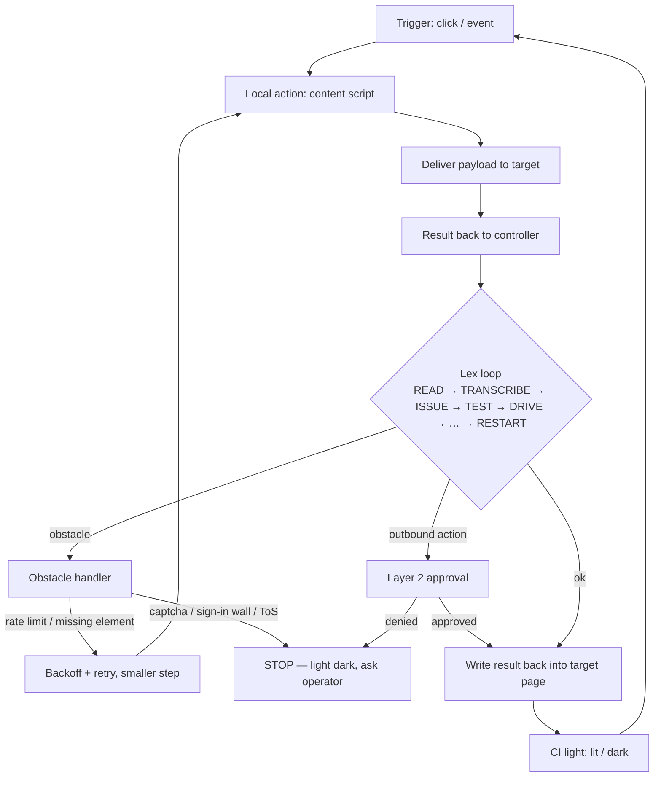

# x-robot design

## 1. Glossary (owner's notes → browser-automation terms)
| Note | Meaning here |
|---|---|
| Force click / IO layer | The click is the **input**; the CI light (lit/dark) is the **output** signal. |
| [trigger] local [action] | A click or event fires a local content script. |
| Info deliver target | The action delivers a payload (data/command) to a target element, page, or API. |
| Get back / drive | The result returns to the controller, which drives the next step. |
| Delivers results back into target | The outcome is written back into the target page (status text, filled field). |
| Temp set / delays pressure | Throttling, debounce, exponential backoff. |
| Target counts obstacles | The target reports obstacles (missing element, captcha, rate limit, sign-in wall); these become delays, retries, or stops. |
| Quantum | Try several paths in parallel, keep the one that works (cf. ternary byte-tree, `Almeidafly/byte-tree`). |
| 1x a-p root fork / problematic forking | One root controller forks child workers; forking is bounded because it is where things go wrong. |
| Layer 2 | A second approval layer for everything that leaves the box (cf. `fitzyracing1/doublehub`). |
| Micro slope | Small step sizes, ramped up gradually while things stay lit. |
| Design problematic systems | Assume failures; design the obstacle path first. |

## 2. The loop

## 3. Components
1. **Root controller** — owns the Lex loop, state, and the fork budget.
2. **Child workers** — forked by the root, one per path/tab; bounded count.
3. **Trigger layer (IO in)** — click/event listeners that start actions.
4. **Content scripts (local actions)** — read the DOM, build and deliver payloads.
5. **Target adapters** — element, page, or API targets; return results + obstacle reports.
6. **Obstacle handler** — classifies obstacles into retry, slow down, or stop.
7. **Pacer** — throttle, debounce, backoff, micro-slope ramp.
8. **Path racer ("quantum")** — runs a few candidate paths, keeps the winner, cancels the rest.
9. **Layer 2 gate** — per-action approval for anything outbound.
10. **Write-back** — puts results into the target page.
11. **Light (IO out)** — lit/dark status per run and per worker.
12. **Log** — every step, payload summary, and decision.

## 4. Scope and safety
- Only sites the operator owns or has written permission to automate (allowlist).
- Respect robots.txt, ToS, and published rate limits; pacer defaults are conservative.
- Captchas are a **stop condition**: never solved, bypassed, or outsourced.
- Sign-in walls stop and hand off to the human; the robot does not handle credentials it wasn't given.
- Every outbound action (submit, post, send, purchase, delete) passes layer 2 approval.
- Fork budget caps parallel workers; path racing never multiplies outbound actions — only read-only paths race.
- Kill switch: one action turns the light dark and stops all workers.

## 5. Phased build plan
1. **Phase 0 – skeleton:** single worker, one allowlisted test page, read-only; light lit/dark.
2. **Phase 1 – trigger→deliver→return:** content script, payload delivery, write-back on a page you own.
3. **Phase 2 – pacer + obstacles:** throttle/debounce/backoff, obstacle classification, stop rules.
4. **Phase 3 – layer 2:** approval gate for outbound actions, audit log.
5. **Phase 4 – root fork:** bounded child workers, micro-slope ramp.
6. **Phase 5 – path racing:** parallel read-only paths, keep the winner; explore byte-tree tie-in.

## 6. Open questions for Joshua
1. Runtime: browser extension, Playwright, or both?
2. Which sites/targets go on the first allowlist?
3. Where does layer 2 approval happen — doublehub, chat, or a local prompt?
4. What exactly turns the light lit vs dark (per step, per run, CI job)?
5. How many child workers max, and what's the micro-slope ramp (e.g. 1→2→4)?
6. How should "quantum" map to the ternary byte-tree — three branches per decision?
7. Which license after review?
